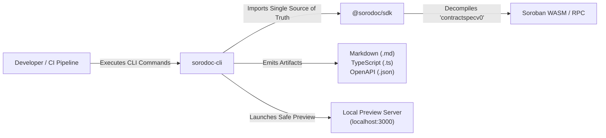

<div align="center">

# sorodoc-cli

### Developer-Facing CLI & CI/CD Documentation Generator for Stellar Soroban

[](https://github.com/SoroDoc-Studio/sorodoc-cli/actions)
[](https://www.npmjs.com/package/sorodoc-cli)
[](https://nodejs.org/)
[](https://opensource.org/licenses/MIT)
[](https://stellar.org/soroban)

**The automated smart contract documentation engine and interactive "Swagger UI" for the Stellar Soroban ecosystem.**

[Overview](#-overview) • [Installation](#-installation) • [Command Matrix](#-command-matrix--cli-reference) • [Sample Terminal Output](#-sample-terminal-output) • [CI/CD Integration](#-cicd-integration-github-actions) • [Docusaurus & VitePress](#-docusaurus--vitepress-recipes) • [Contributing](#-contributing)

</div>

---

## 📖 Overview

`sorodoc-cli` is the terminal interface and automated build tool for the **SoroDoc** toolchain. Designed for smart contract engineers, frontend developers, and CI/CD pipelines, it extracts embedded specification metadata directly from compiled Soroban `.wasm` binaries or deployed on-chain contract addresses without requiring Rust toolchains or local node dependencies.

With a single terminal command, `sorodoc-cli` can:
- **Inspect** function signatures, arguments, and custom error enums right in your console.
- **Generate** production Markdown documentation, typed TypeScript client bindings, and OpenAPI 3.0 schemas.
- **Validate** documentation completeness and enforce zero undocumented entry points before Mainnet deployments.
- **Serve** an instant, zero-dependency local documentation preview server with hot reloading.

---

## 🏗️ Architecture & Ecosystem Fit



---

## 📦 Installation

Execute `sorodoc` directly with `npx` (zero install) or install globally across your developer environment:

```bash
# Direct zero-install execution
npx sorodoc --help

# Global installation via npm
npm install -g sorodoc-cli

# Global installation via pnpm or yarn
pnpm add -g sorodoc-cli
yarn global add sorodoc-cli
```

Verify your installation:
```bash
sorodoc --version
```

---

## 💻 Command Matrix & CLI Reference

| Command | Arguments / Flags | Description |
| :--- | :--- | :--- |
| `sorodoc inspect <wasm>` | `--network <testnet\|mainnet>`, `--rpc <url>` | Displays a structured terminal summary of functions, inputs, return types, structs, and errors. |
| `sorodoc generate <wasm>` | `-o, --output <file>`<br>`-f, --format <markdown\|typescript\|json>`<br>`-t, --title <title>` | Decompiles specifications and writes generated documentation or typed client bindings. |
| `sorodoc openapi <wasm>` | `-o, --output <file>`<br>`-t, --title <title>` | Generates an OpenAPI 3.0.3 specification schema representing contract entry points. |
| `sorodoc validate <wasm>` | `--strict` | Scans for missing docstrings, duplicate identifiers, and documentation completeness (exits code 1 on failure). |
| `sorodoc serve <directory>` | `-p, --port <port>` (default: 3000)<br>`-H, --host <host>` (default: 127.0.0.1) | Launches a security-hardened local HTTP documentation preview server. |

---

## 🖥️ Sample Terminal Output

When you run `sorodoc inspect` against a compiled Soroban contract:

```bash
sorodoc inspect ./target/wasm32-unknown-unknown/release/liquidity_pool.wasm
```

You receive a human-readable, formatted terminal inspection summary:

```text
┌────────────────────────────────────────────────────────────────────────┐
│ SoroDoc Contract Inspector: liquidity_pool.wasm                        │
│ Protocol Version: 21+ | Spec Format: contractspecv0                   │
└────────────────────────────────────────────────────────────────────────┘

📌 FUNCTIONS (4)
┌───────────────┬──────────────────────────────────┬─────────────────────┐
│ Name          │ Parameters                       │ Return Type         │
├───────────────┼──────────────────────────────────┼─────────────────────┤
│ initialize    │ admin: Address, token_a: Address │ void                │
│ deposit       │ to: Address, amount: i128        │ Shares (UDT)        │
│ swap          │ to: Address, amount_in: i128     │ i128                │
│ get_reserves  │ (none)                           │ (i128, i128)        │
└───────────────┴──────────────────────────────────┴─────────────────────┘

📦 USER DEFINED TYPES (2)
┌───────────────┬──────────┬─────────────────────────────────────────────┐
│ Name          │ Kind     │ Field Definitions                           │
├───────────────┼──────────┼─────────────────────────────────────────────┤
│ Shares        │ Struct   │ count: u32, last_update: u64                │
│ PoolStatus    │ Enum     │ Active (0), Paused (1), Liquidating (2)     │
└───────────────┴──────────┴─────────────────────────────────────────────┘

⚠️ CUSTOM ERROR DICTIONARY (3)
┌───────────────┬───────┬────────────────────────────────────────────────┐
│ Error Name    │ Code  │ Description                                    │
├───────────────┼───────┼────────────────────────────────────────────────┤
│ AlreadyInit   │ 1001  │ Contract has already been initialized.         │
│ Insufficient  │ 1002  │ Inbound deposit amount is below minimum dust.  │
│ SlippageFail  │ 1003  │ Output amount violated max slippage tolerance. │
└───────────────┴───────┴────────────────────────────────────────────────┘

✓ Spec verification passed: 100% of functions documented.
```

---

## 🤖 CI/CD Integration (GitHub Actions)

Enforce that smart contract documentation and TypeScript interfaces never drift out of sync with code changes. Add this workflow to your repository to automatically build documentation on `cargo build` and publish it to GitHub Pages:

```yaml
# .github/workflows/contract-docs.yml
name: Smart Contract Documentation Pipeline

on:
  push:
    branches: [main]
  pull_request:
    branches: [main]

jobs:
  build-and-document:
    runs-on: ubuntu-latest
    steps:
      - name: Checkout Repository
        uses: actions/checkout@v4

      - name: Setup Rust & WASM Target
        uses: dtolnay/rust-toolchain@stable
        with:
          targets: wasm32-unknown-unknown

      - name: Setup Node.js
        uses: actions/setup-node@v4
        with:
          node-version: 22.x

      - name: Build Soroban Contract WASM
        run: |
          cargo build --target wasm32-unknown-unknown --release

      - name: Install SoroDoc CLI
        run: npm install -g sorodoc-cli

      - name: Validate Contract Documentation Completeness
        run: |
          sorodoc validate ./target/wasm32-unknown-unknown/release/contract.wasm

      - name: Generate Markdown Documentation & TypeScript Client
        run: |
          mkdir -p docs/contracts
          sorodoc generate ./target/wasm32-unknown-unknown/release/contract.wasm -f markdown -o docs/contracts/contract.md
          sorodoc generate ./target/wasm32-unknown-unknown/release/contract.wasm -f typescript -o docs/contracts/contract.ts
          sorodoc openapi ./target/wasm32-unknown-unknown/release/contract.wasm -o docs/contracts/openapi.json

      - name: Deploy Docs to GitHub Pages
        if: github.ref == 'refs/heads/main'
        uses: peaceiris/actions-gh-pages@v4
        with:
          github_token: ${{ secrets.GITHUB_TOKEN }}
          publish_dir: ./docs
```

---

## 📑 Docusaurus / VitePress Recipes

`sorodoc-cli` emits standard GitHub-flavored Markdown that integrates seamlessly with static site generators like **Docusaurus** and **VitePress**.

### Docusaurus Recipe
Add an npm script to your `package.json`:

```json
{
  "scripts": {
    "docs:contracts": "sorodoc generate ../contracts/target/wasm32-unknown-unknown/release/vault.wasm -f markdown -o docs/contracts/vault.md --title 'Vault Smart Contract'"
  }
}
```

Prepend frontmatter to match your Docusaurus sidebar structure:
```bash
echo -e "---\nsidebar_position: 2\ntitle: Vault Contract\n---\n$(cat docs/contracts/vault.md)" > docs/contracts/vault.md
```

---

## 🤝 Contributing

We welcome contributions, bug fixes, and feature requests. Please check [CONTRIBUTING.md](./CONTRIBUTING.md) and review [ARCHITECTURE.md](./ARCHITECTURE.md) for local testing instructions.

---

## 📄 License

This project is licensed under the [MIT License](./LICENSE).
